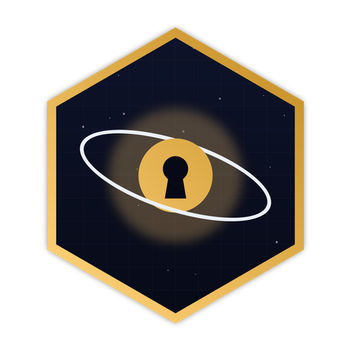

<p align="center">
  
</p>

<h1 align="center">SpaceOne</h1>

<p align="center">
  <strong>Your seeds. Your device. No one else.</strong><br/>
  A local seed phrase vault with end-to-end encryption — no account, no server, no tracking.
</p>

<p align="center">
  <code>AES-256-GCM</code> · <code>Argon2id</code> · <code>BIP39</code> · <code>100% offline</code> · <code>open source</code>
</p>

---

## What it is

SpaceOne stores your crypto wallet seed phrases **on your own device only**. There is no server, no account, no cloud and no telemetry: your words are encrypted right in the browser and never leave it.

- 🔑 **Sovereign password** — on first use you create the vault password. It is never stored: the encryption key is derived from it (Argon2id + HKDF). A wrong password doesn't get an "access denied" — it simply decrypts nothing.
- 🔒 **AES-256-GCM** — every seed is encrypted with the same standard used by banks, with a 256-bit key and integrity authentication.
- 🎲 **BIP39 generator** — create 12-word seeds in the wallet standard (Phantom, MetaMask, Ledger…) or store your own custom phrases.
- 👁 **Password to reveal** — viewing a seed requires typing the password again, even with the vault open.
- 💾 **Encrypted backup** — export a file that only opens with your password and take your vault to any computer.
- 📴 **Offline by default** — works without internet (installable PWA).

## Download

Grab the ZIP from [`download/SpaceOne-v1.0.0.zip`](download/SpaceOne-v1.0.0.zip) (or the latest [Release](../../releases)), extract it and double-click **index.html**. That's it — no install, no server.

## Run from source

Requires [Node.js 18+](https://nodejs.org)

```bash
cd frontend
npm install
npm start
```

Open **http://localhost:3000**. On Windows you can also use `.\start.ps1` at the project root.

Production build (static files, servable anywhere or opened straight from disk):

```bash
cd frontend
npm run build
```

## How the security works

```
password ──Argon2id──▶ master key ──HKDF──▶ KEK ──wraps──▶ DEK
                                                            │
seeds ◀──────────────── AES-256-GCM ◀───────────────────────┘
```

1. Your password goes through **Argon2id** (a memory-hard function, OWASP parameters) and becomes a key — a one-way process; the key cannot reveal the password.
2. That key wraps the **DEK**, the random key that encrypts your seeds with **AES-256-GCM**.
3. Only the salt, the wrapped DEK and the encrypted blobs ever touch disk. **Neither the password nor the seeds are ever written in plain text.**
4. A wrong password derives a different key — and GCM authentication fails. Math, not locks.

### What SpaceOne *cannot* do, by design

- It cannot see your seeds
- It cannot recover your password (there is no "forgot password" — write it down)
- It cannot track what you store

> ⚠️ **Important:** if you forget your password, there is no recovery. Clearing your browser data wipes the vault — keep an exported backup. And anyone with your password and access to your device can open the vault: use your operating system's screen lock.

## Project structure

```
frontend/            the app (React)
  src/App.js         vault UI and flows
  src/crypto.js      cryptography (Argon2id, HKDF, AES-256-GCM)
  public/            PWA, icons and logo
download/            ready-to-use ZIP build
start.ps1            launches the app on Windows
```

## Verify it yourself

We are not asking for your trust — we are asking for your audit. All the cryptography lives in [`frontend/src/crypto.js`](frontend/src/crypto.js) (~100 lines), built on the audited [`@noble/hashes`](https://github.com/paulmillr/noble-hashes) and [`@scure/bip39`](https://github.com/paulmillr/scure-bip39) libraries and the browser's Web Crypto API.

## License

[MIT](LICENSE) — free to use, study, modify and distribute.

---

<p align="center"><sub><code>trust the math, not the middleman</code></sub></p>
